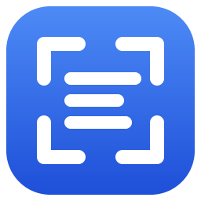

<div align="center">



# SnipGlyph

**A lightweight, pure-Go Windows tray utility for offline OCR, translation, and clipboard history.**

[](https://github.com/Aliothmoon/SnipGlyph/releases/latest)
[](https://github.com/Aliothmoon/SnipGlyph/releases/latest)
[](go.mod)

**English** · [简体中文](README.zh-CN.md)

</div>

---

## Highlights

- **Single binary, zero runtime bloat** — Pure Go (`CGO_ENABLED=0`), native Win32/Walk UI, stays quiet in the system tray.
- **Offline OneOCR in an isolated worker** — Runs OCR in a child process that unloads after 10 minutes idle, keeping tray memory tiny and crashes isolated.
- **Instant clipboard history** — SQLite-backed with full-text search, custom tabs, pinning, inline editing, images, and file paths; ignores private entries from password managers.
- **Bilingual & portable** — Automatically follows your Windows UI language (`English` / `简体中文`) with live switching in Settings, and supports full portable mode.

## Features & Default Hotkeys

| Feature | Description | Default Hotkey |
|---|---|---|
| **Screenshot OCR** | Capture a region or window, edit text, copy, or translate | `Win+Alt+Shift+C` |
| **Silent OCR** | Recognize text and copy directly to clipboard with a lightweight toast | `Win+Alt+C` |
| **Screenshot Translate** | Capture a region and translate immediately | `Win+Alt+S` |
| **Selection Translate** | Translate selected text in the active app (UI Automation first, Ctrl+C fallback) | `Win+Alt+X` |
| **Input Translate** | Open a quick popup prefilled with clipboard text | `Win+Alt+I` |
| **Clipboard History** | Searchable, tabbed panel for text, rich text, images, and files | `Alt+V` |

All hotkeys, UI language, Baidu Translate credentials, proxy settings (System / Direct / Custom HTTP or SOCKS5), history switches, and Windows startup can be configured in **Tray → Settings** and take effect immediately without restarting.

## Quick Start

1. Download the latest release from [GitHub Releases](https://github.com/Aliothmoon/SnipGlyph/releases/latest):
   - **Standard**: `snipglyph-v*-windows-amd64.exe` (stores settings in `%APPDATA%\SnipGlyph` and data in `%LOCALAPPDATA%\SnipGlyph`)
   - **Portable**: `snipglyph-v*-windows-amd64-portable.zip` (extract and run; keeps everything inside `data\`)
2. Run `snipglyph.exe`. Since the binary is unsigned, Windows SmartScreen may show a prompt on first launch — click **More info → Run anyway**.
3. Click the tray icon to open **Settings** to customize hotkeys, language, or translation API keys.

## OneOCR Setup

SnipGlyph uses Microsoft's offline **OneOCR** engine (x64) and locates it in the following order:

1. **Custom directory** *(optional)* — Set `ocr.dir` in `config.json` (relative paths resolve against the executable's folder) or set the `SNIPGLYPH_ONEOCR_DIR` environment variable.
2. **Local files next to `snipglyph.exe`** *(no Microsoft Store or Snipping Tool required)* — Place x64 `oneocr.dll`, `oneocr.onemodel`, and `onnxruntime.dll` in either a `oneocr\` subfolder (recommended) or directly beside the executable:
   ```text
   SnipGlyph/
   ├── snipglyph.exe
   └── oneocr/
       ├── oneocr.dll
       ├── oneocr.onemodel
       └── onnxruntime.dll
   ```
3. **Windows 11 Snipping Tool** *(automatic fallback)* — Automatically detected from the installed Microsoft Store package.

> [!NOTE]
> OneOCR's model loader reads the model path using the Windows ANSI code page. SnipGlyph automatically falls back to Windows 8.3 short paths when needed, but keeping the files in an ASCII path avoids encoding issues on volumes with short names disabled.

## Portable Mode

Enable portable mode on any `snipglyph.exe` using any of the following (in priority order):

1. Launch with `snipglyph.exe --portable`
2. Set environment variable `SNIPGLYPH_PORTABLE=1`
3. Place an empty file named `portable` (or `portable.txt`) next to `snipglyph.exe`

All writable files are kept under `<exeDir>\data\`, cleanly separated from a local `<exeDir>\oneocr\` folder:

```text
SnipGlyph/
├── snipglyph.exe
├── portable
├── oneocr/                 # Optional local OneOCR files
└── data/
    ├── config.json         # Settings (API keys encrypted with Windows DPAPI)
    ├── history.db          # OCR & translation history (SQLite FTS5)
    ├── clipboard.db        # Clipboard history (SQLite FTS5)
    ├── logs/snipglyph.log  # Size-capped rotating log
    └── cache/oneocr/       # Staging cache (used only when loading from MSIX)
```

> [!TIP]
> Stored API keys in `config.json` are protected with Windows DPAPI (bound to the current Windows user and machine). When moving a portable folder to another PC or account, all other settings stay intact — simply re-enter your API key in Settings.

## Clipboard History Shortcuts

<details>
<summary>View keyboard shortcuts inside the Clipboard History panel (<code>Alt+V</code>)</summary>

| Key | Action |
|---|---|
| Type directly | Filter current tab (space-separated terms) |
| `↑` `↓` / `PgUp` `PgDn` / `Ctrl+Home` `End` | Navigate items |
| `Enter` / Double-click | Paste into the previously active window |
| `Shift+Enter` | Paste as plain text (strips HTML / RTF) |
| `Ctrl+C` | Copy to clipboard without pasting |
| `Ctrl+P` | Pin / unpin item |
| `F2` | Edit text item (`Ctrl+S` to save, `Esc` to cancel) |
| `Del` (`Shift+Del` while searching) | Delete item |
| `Ctrl+Tab` / `Ctrl+Shift+Tab` | Switch tabs |
| Right-click | Move/copy between tabs, or add/rename/delete tabs |

</details>

## Build from Source

Requires Go 1.26+ on Windows:

```sh
# Build release binary
CGO_ENABLED=0 go build -ldflags "-H windowsgui -s -w" -o bin/snipglyph.exe ./cmd/snipglyph

# Run tests
go test ./...
```

If you modify `winres/winres.json` or `winres/icon.png`, regenerate the embedded Windows resources first:

```sh
go generate ./cmd/snipglyph
```

## Disclaimer

This repository and its releases do **not** include or redistribute any Microsoft files. OneOCR belongs to Microsoft and is loaded at runtime from local files you provide or from your installed Windows Snipping Tool. This project is not affiliated with or endorsed by Microsoft.
